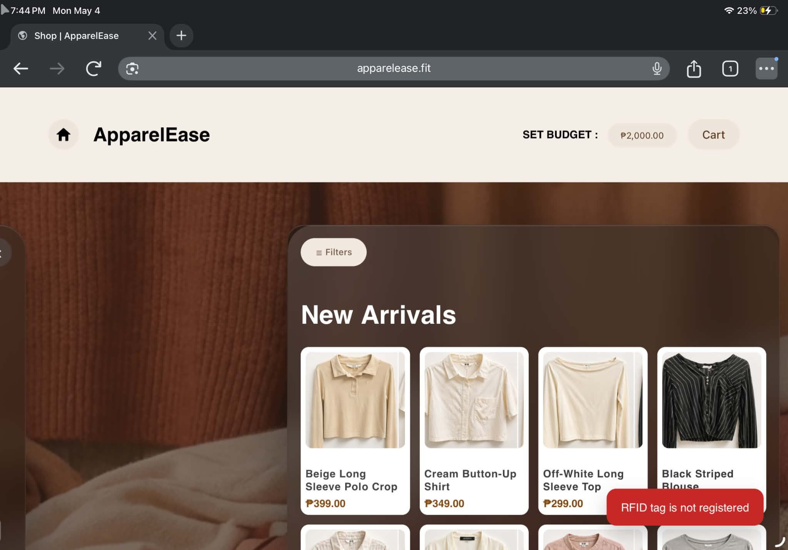
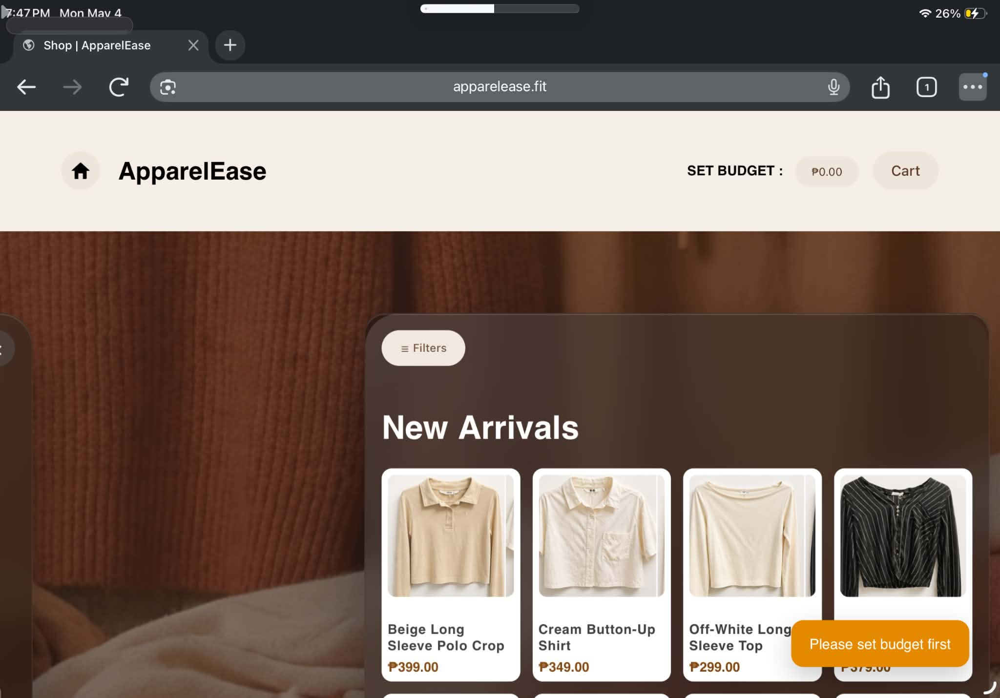
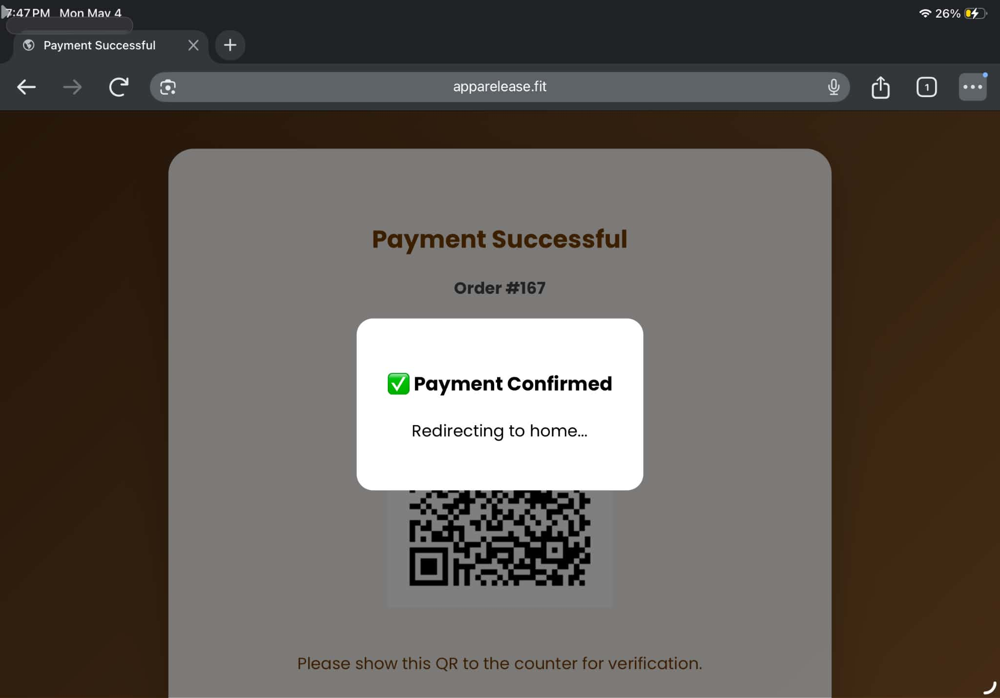
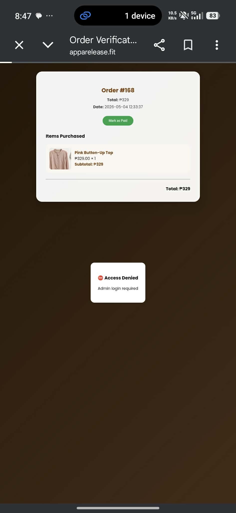
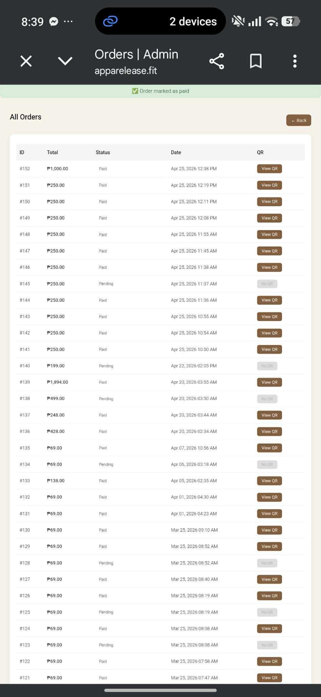
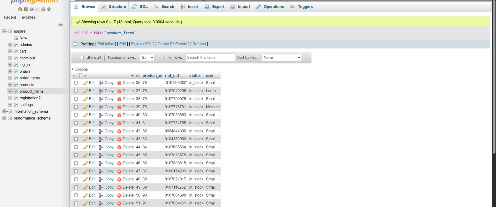

# Apparel Shopping Assistant System

The Apparel Shopping Assistant System is a web-based shopping and budget management platform developed as an academic thesis project in Computer Engineering. It aims to enhance the apparel shopping experience by integrating product management, inventory tracking, budget monitoring, and RFID-based product identification into a unified system.

Built using PHP, JavaScript, HTML, CSS, and MySQL, the system provides an interactive shopping environment where users can browse apparel products, manage their shopping carts, monitor their spending against a set budget, and proceed through the checkout process. RFID integration supports product identification, while QR code-based receipts provide a digital reference for completed transactions.

The project demonstrates the integration of web application development, database management, and hardware-assisted identification to support a more organized and technology-driven apparel shopping experience.

## Project Overview

The Apparel Shopping Assistant System is designed to provide a more convenient and structured approach to apparel shopping by combining essential e-commerce functionalities with budget management and RFID technology.

Unlike a conventional online shopping interface, the system incorporates budget-related features that allow users to establish spending limits and monitor their purchases throughout the shopping process. This helps users make more informed purchasing decisions while keeping their selections within their intended budget.

The system also integrates RFID-based product identification to support the identification of apparel items during shopping-related operations. Combined with inventory management and database-driven product records, this functionality helps connect physical product identification with the system's digital shopping environment.

Core System Components

Product and Inventory Management – Organizes apparel product information and maintains inventory-related records.

Shopping and Cart Management – Allows users to browse available products, select items, and manage their shopping cart.

Budget Management – Provides budget-setting and budget-limit validation functionality to help users monitor their planned spending.

RFID-Based Product Identification – Integrates RFID scanning to support product identification within the shopping process.

Checkout and Payment Processing – Supports the checkout workflow and transaction-related processes.

QR Code-Based Receipts – Generates QR code-based receipts to provide a digital reference for transactions.

Through these integrated components, the project demonstrates how web technologies, database systems, and RFID functionality can work together to create a more organized and budget-conscious apparel shopping experience.

## Technologies Used

- **Backend:** PHP
- **Frontend:** HTML, CSS, JavaScript
- **Database:** MySQL
- **Hardware Integration:** RFID
- **Development Tools:** Visual Studio Code, XAMPP, GitHub

## Key Features

- **Product Management** – Manage apparel products and inventory information.
- **Shopping Cart** – Add and manage products in the shopping cart.
- **RFID Integration** – Support product identification through RFID scanning.
- **Checkout Functionality** – Process shopping cart checkout.
- **Database Management** – Store and manage product and transaction-related information.
- **QR Code Receipt** – Generate QR code-based receipts.

## Project Structure

```text
apparel_rfid/
├── phpqrcode/
├── products/
├── admin.php
├── admin_login.php
├── add_product.php
├── edit_product.php
├── remove_product.php
├── products.php
├── shop.php
├── cart.php
├── create_checkout.php
├── rfid_scan.php
├── qr_receipt.php
├── db.php
└── README.md
```

## Installation and Setup

1. Install [XAMPP](https://www.apachefriends.org/).
2. Clone or download this repository.
3. Place the project folder inside the XAMPP `htdocs` directory.
4. Start Apache and MySQL using the XAMPP Control Panel.
5. Create the required MySQL database using phpMyAdmin.
6. Import the project's database SQL file, if available.
7. Configure the database connection in `db.php` using your local database credentials.
8. Open your browser and access:

```text
http://localhost/apparel_rfid/
```

## Development

This project was developed as part of an academic thesis in Computer Engineering.

AI-assisted development tools were utilized to support coding, debugging, and troubleshooting throughout development.

## Contributors

Developed as an academic thesis project by the project team.

## Disclaimer

This repository is intended for educational and portfolio purposes.


## Screenshots

### Homepage


### Product Shopping Interface


### RFID Product Identification



### Budget Setting Interface



### Budget Limit Validation


### Payment Confirmation QR Code



### Order Verification Page



### Admin Login Interface


### Admin Order Management



### Admin Access Denied


### MySQL Database Structure




