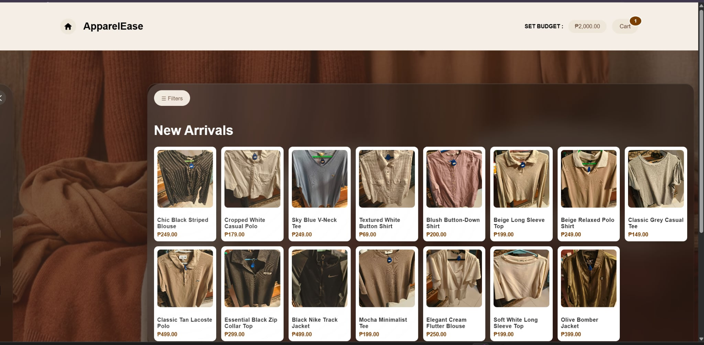
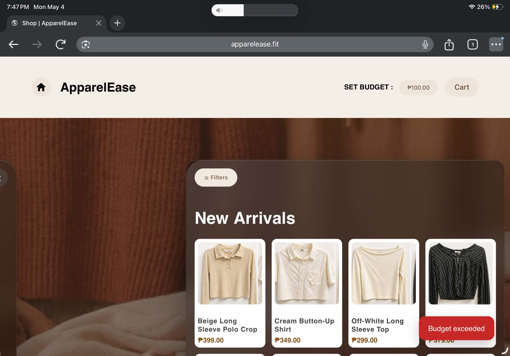
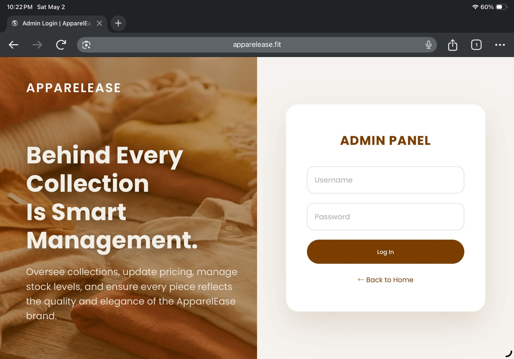

# Apparel Shopping Assistant System

A web-based apparel shopping assistant developed as an academic thesis project using PHP, JavaScript, HTML, CSS, and MySQL. The system incorporates RFID-based product identification and inventory-related functionality.

## Project Overview

The Apparel Shopping Assistant System is designed to support apparel shopping through product management, inventory tracking, and shopping cart functionality. It combines web technologies with RFID-based functionality to support product identification and shopping-related processes.

## Technologies Used

- **Backend:** PHP
- **Frontend:** HTML, CSS, JavaScript
- **Database:** MySQL
- **Hardware Integration:** RFID
- **Development Tools:** Visual Studio Code, XAMPP, GitHub

## Key Features

- **Product Management** – Manage apparel products and inventory information.
- **Shopping Cart** – Add and manage products in the shopping cart.
- **RFID Integration** – Support product identification through RFID scanning.
- **Checkout Functionality** – Process shopping cart checkout.
- **Database Management** – Store and manage product and transaction-related information.
- **QR Code Receipt** – Generate QR code-based receipts.

## Project Structure

```text
apparel_rfid/
├── phpqrcode/
├── products/
├── admin.php
├── admin_login.php
├── add_product.php
├── edit_product.php
├── remove_product.php
├── products.php
├── shop.php
├── cart.php
├── create_checkout.php
├── rfid_scan.php
├── qr_receipt.php
├── db.php
└── README.md
```

## Installation and Setup

1. Install [XAMPP](https://www.apachefriends.org/).
2. Clone or download this repository.
3. Place the project folder inside the XAMPP `htdocs` directory.
4. Start Apache and MySQL using the XAMPP Control Panel.
5. Create the required MySQL database using phpMyAdmin.
6. Import the project's database SQL file, if available.
7. Configure the database connection in `db.php` using your local database credentials.
8. Open your browser and access:

```text
http://localhost/apparel_rfid/
```

## Development

This project was developed as part of an academic thesis in Computer Engineering.

AI-assisted development tools were utilized to support coding, debugging, and troubleshooting throughout development.

## Contributors

Developed as an academic thesis project by the project team.

## Disclaimer

This repository is intended for educational and portfolio purposes.


## Screenshots

### Homepage


### Product Shopping Interface



### RFID Product Identification


### Budget Setting Interface


### Budget Limit Validation



### Payment Confirmation QR Code


### Order Verification Page


### Admin Login Interface



### Admin Order Management


### Admin Access Denied


### MySQL Database Structure


